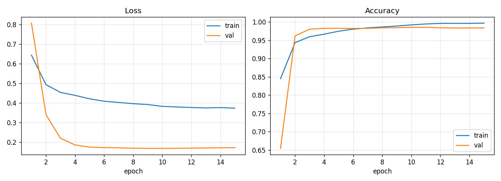
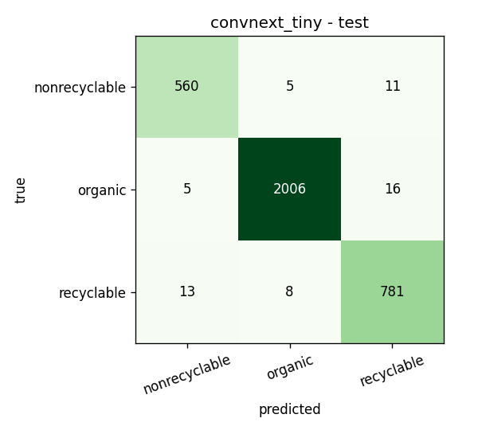

# EcoSort

A CNN that sorts waste into **organic**, **recyclable** and **non-recyclable** from a photo, plus a web app that classifies items live from your camera.

| Split | Accuracy | Macro-F1 |
|---|---|---|
| Validation | 98.53% | 0.981 |
| **Test** | **98.30%** | **0.977** |

Model: ConvNeXt-Tiny (ImageNet-22k pretrained), fine-tuned for 3 classes, 27.8M params. Test numbers come from a held-out split that was used only once, after training finished.

## Results





Test F1 per class: organic 0.992, non-recyclable 0.971, recyclable 0.970.

Test accuracy per item type:

| Item | Acc | Item | Acc |
|---|---|---|---|
| bulbs | 100% | glass | 97.9% |
| tissues_napkins | 100% | Styrofoam_and_food_boxes | 96.4% |
| organic | 99.0% | paper_cardboard | 96.6% |
| e-waste | 98.8% | biohazard_medical_products | 96.6% |
| plastic_rigid | 98.7% | plastic_and_wooden_utensils | 96.1% |
| batteries | 98.0% | metal | 96.0% |
| | | snack_wraps | 90.9% |

Full metrics are in [results/convnext_tiny/metrics.json](results/convnext_tiny/metrics.json).

## Dataset

The dataset is not included in the repo because of its size (~830 MB). Put it in `dataset/` like this:

```
dataset/
  organic/            *.jpg
  recyclable/         glass/ metal/ paper_cardboard/ plastic_rigid/
  nonrecyclable/      batteries/ bulbs/ e-waste/ snack_wraps/ ...
```

The model is trained on the 3 top-level classes. The item subfolders are not trained as separate classes, because their sizes vary a lot (61 to 1,585 images). They are still used to:

- stratify the train/val/test split, so every item type appears in all three splits in the same proportion;
- report accuracy per item type.

`nonrecyclable/logo/` is excluded, because it contains recycling signs rather than waste items.

## How it works

1. **`src/prepare_data.py`** removes duplicates and splits the data.
   - Duplicates and near-duplicates are found with perceptual hashing. 1,545 were removed, plus 22 images that appeared under two different labels.
   - Without this, copies of the same image could land in both train and test and inflate the test score.
   - The rest is split 70/15/15, stratified by item type: 15,889 train / 3,405 val / 3,405 test.
2. **`src/train.py`** fine-tunes the model.
   - Organic makes up 60% of the data, so the loss is class-weighted to counter the imbalance.
   - Training uses AdamW with a cosine learning rate, mixed precision, EMA weights, label smoothing, and TrivialAugment augmentation.
   - The best epoch is chosen by val macro-F1. The test set is then evaluated once, with flip test-time augmentation.
3. **`src/calibrate.py`** makes the confidence numbers trustworthy.
   - The class weighting and label smoothing make raw confidences too low. Correct organic predictions averaged only 82%.
   - A temperature and per-class bias are fitted on the val set, which brings the test calibration error from 0.118 down to 0.007.
   - So when the app shows 95%, the model is right about 95% of the time.

## Setup

```bash
# GPU build of PyTorch (pick the CUDA version for your driver: https://pytorch.org)
pip install torch torchvision --index-url https://download.pytorch.org/whl/cu121
pip install -r requirements.txt
```

## Run the live demo

```bash
python app/server.py
```

Open http://localhost:8000 and click **Start camera**. Hold one item inside the scan box.

- The app shows the predicted bin, a confidence ring, bars for all 3 classes, FPS and model latency. It takes about 10 ms per frame on an RTX 3050 Ti. It also runs on CPU, just slower.
- **Uncertain below** marks low-confidence frames as "Uncertain" instead of guessing.
- **Smoothing** averages predictions across frames to stop flicker.
- **Upload image** classifies a single photo.

## Retrain

```bash
python src/prepare_data.py                 # dedupe + split -> splits/*.csv
python src/train.py --arch convnext_tiny   # ~1-1.5 h on a 4 GB laptop GPU
python src/calibrate.py models/convnext_tiny.pt
```

- Add `--resume` to `train.py` to continue an interrupted run.
- While training runs, Windows is kept from sleeping, because sleep kills the CUDA context.

## Project layout

```
src/prepare_data.py   dedupe + stratified split
src/train.py          training + test evaluation
src/calibrate.py      confidence calibration
src/models.py         model definition / checkpoint loading
app/server.py         FastAPI inference server
app/static/           web UI (camera, overlay, confidence bars)
models/               trained checkpoint (fp16, 56 MB)
results/              metrics, curves, confusion matrices
splits/               the exact train/val/test file lists
```
